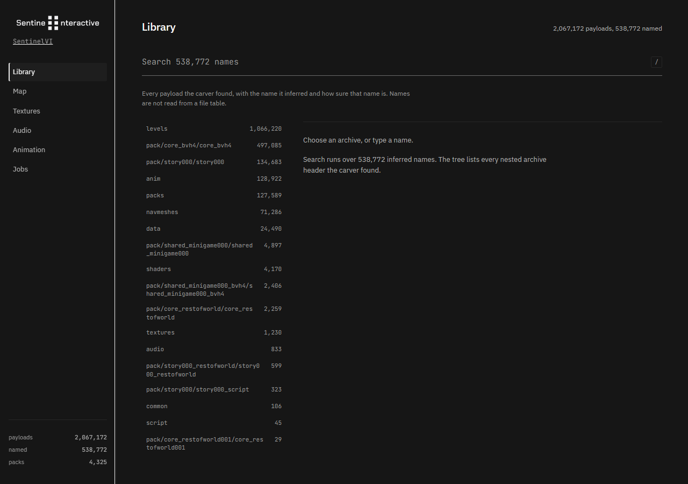
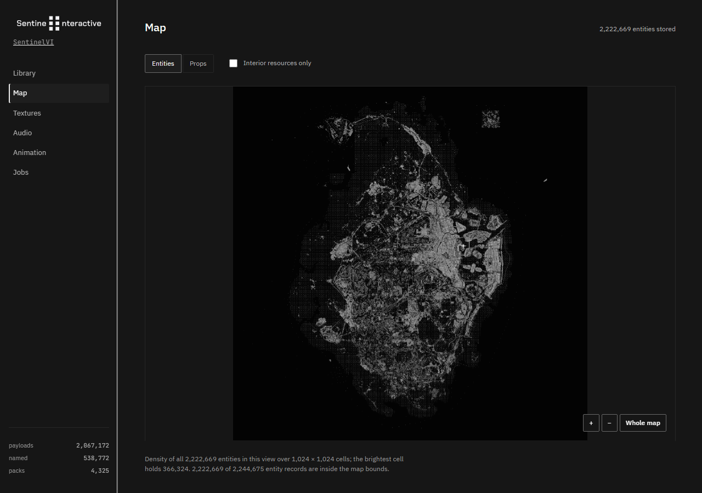
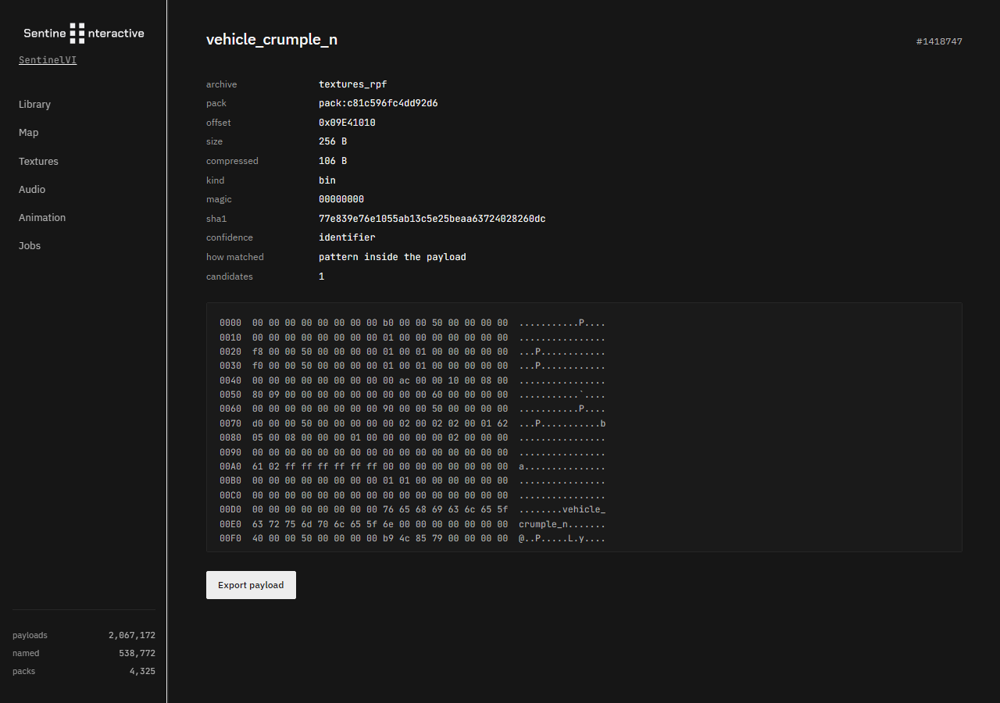

# SentinelVI

An inspector for a GTA VI game install you already have on disk. It lists the payload streams carved out of the archives, the names inferred for them, the placement records in the map resources, the texture databases, the audio banks and the animation clips, and it exports a single payload when you ask for one.

SentinelVI by SentinelInteractive. Source and crate code are MIT.

## What it does not do

It does not decrypt anything, does not hold keys, does not render meshes and does not play animation poses. Every list on screen is backed by a row in an index built from the game files; when an index has not been built, the screen says so and names the command that builds it.

## Requirements

- Windows with the game installed locally (the paths below assume `D:\GTA6`).
- Rust 1.80 or newer for building.
- The sidecar indexes in the data root:
  - `vi_toc.db`, the reconstructed directory and name index
  - `bin_store/`, the carved payload store used for exports

The placement, animation and audio indexes are built by this tool.

## Build

```powershell
cargo build --release --offline
```

Binaries land in `target\release\`: `sentinel.exe` (command line and local server) and `sentinel-server.exe` (server only).

## Run

```powershell
target\release\sentinel.exe ui
```

That binds `127.0.0.1:7710`, serves the interface from `web\` and opens the browser. `--port` changes the port, `--no-open` skips the browser.

Data path: `SENTINEL_DATA`, default `D:\GTA6`. The game directory is the first child of that root that contains `levels.rpf`; set `SENTINEL_GAME` to point at it directly.

## Commands

| Command | What it does |
| --- | --- |
| `sentinel info` | data paths, archive sizes, which indexes exist |
| `sentinel toc stats` | payload, name, pack and confidence counts |
| `sentinel toc search <text>` | name search from the terminal |
| `sentinel toc archives` | nested archive headers grouped by archive |
| `sentinel export <id> [--out DIR]` | write one decoded payload to disk |
| `sentinel index placement` | scan `levels.rpf`, write `sentinel\placement.sqlite` |
| `sentinel index anim` | scan `anim.rpf`, write `sentinel\anim.sqlite` |
| `sentinel index audio` | scan `audio.rpf`, write `sentinel\audio.sqlite` |
| `sentinel textures list` | every `.ttpf` database with its texture count |
| `sentinel anim list` | first clips from the animation index |
| `sentinel audio list` | first banks from the audio index |
| `sentinel ui` | start the local server |

## Screens







- **Library**: archive tree from `vi_toc.db`, search over the inferred names, confidence per row, inspector with the selected payload.
- **Asset**: one payload with its archive, pack, offset, sizes, hash, confidence and the first bytes of its decoded payload. One action: export it.
- **Map**: placement density over the whole map from a 1,024 x 1,024 raster of every stored record, with the heightmap terrain from `common.rpf` behind it. Zoom past 5 km and it switches to at most 20,000 points spread across the view. Entities or props, interior resources only, pan and zoom.
- **Textures**: `.ttpf` databases, their texture descriptors, a decoded preview for BC1, BC3, BC5 and BC7 surfaces, PNG export.
- **Audio**: ADAT banks with stream count, sample count and rate, played as Ogg Opus.
- **Animation**: clip records with frame count, duration and keyframe count. Names are shown only where the resource holds one name per record.
- **Jobs**: exports and index builds, with their state and output path.

## How the numbers are produced

`sentinel toc stats` on this install reports 2,067,172 payload streams, 538,772 with an inferred name, in 4,325 nested archive headers. Those names are inferred from payload contents and path prefixes, not read from a file table, so each row carries the way it was matched: `exact`, `from path`, `pattern` or `weak`.

The placement index stores every entity record inside the map bounds and one prop instance in four; the Map screen states that ratio. Grass instances are counted by the research tool but are not in the index.

## Keyboard

`/` focuses the search field, arrow keys move through rows and pan the map, Enter opens the selected row, Escape clears the search or the selection. Every control is reachable with Tab and has a visible focus ring.

## Licence

MIT. See `LICENSE`. The crate in `crates/core` is a copy of `sentinel-rpf9-core`, also MIT.


